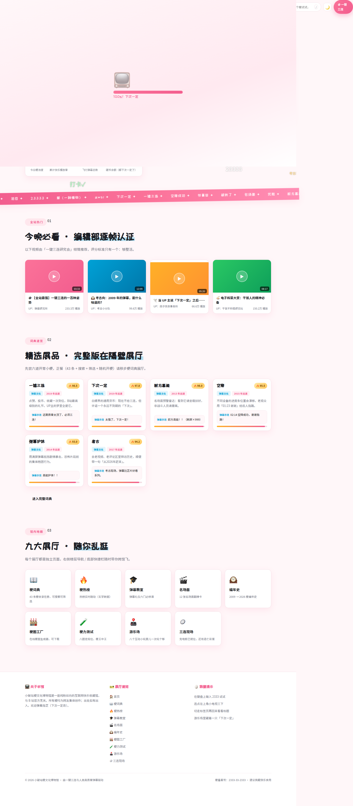
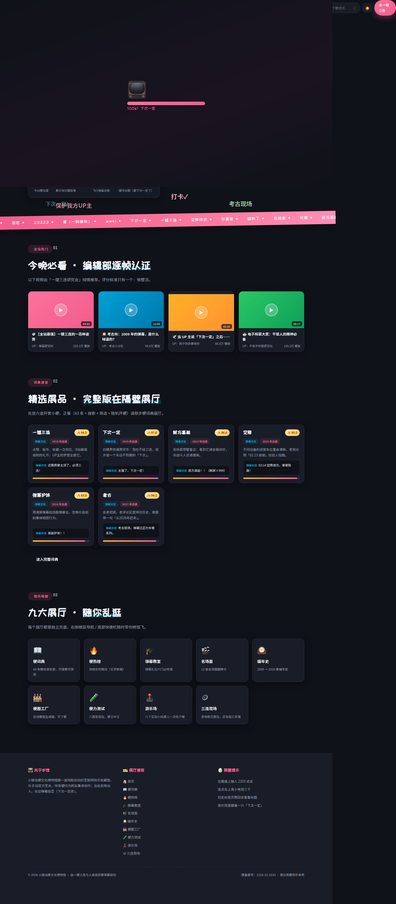

# 小破站梗文化博物馆 📺

> **一代人的互联网快乐，按年份封存，按展厅陈列。**
> 非官方 · 纯整活 · 零框架 · 零构建

<p>
  
  
  
  
  
</p>

一个以 **B 站（哔哩哔哩）弹幕文化**为主题的梗文化互动网站：从 2009 年建站到 2026 年的新梗，43 条热梗词典、五大名场面小游戏、八个互动小玩意儿，全部塞进一座 12 展厅的虚拟博物馆。

| 浅色 | 深色 |
| --- | --- |
|  |  |

---

## ✨ 特性总览

- 📺 **12 个独立展厅**——词典、热榜、教室、名场面、编年史、工厂、测试、游乐场、梗游厅、哲♂学厅、三连现场
- 🕹️ **5 个梗文化小游戏**——冰红茶翻瓶（物理引擎）、牢大肘击（限时街机）、鸡你太美（四键音游）、电子木鱼（修行计数）、奥利给分贝机（支持真麦克风）
- 🧪 **8 个互动小玩意儿**——梗运势、记忆翻牌、手速大作战、三连大作战、猜拳、梗浓度检测仪、梗命转盘、梗码工坊
- 🕰️ **滚动驱动编年史长卷**——时间轴随滚动生长，年度弹幕逐一点亮（CSS 原生 `animation-timeline: view()`，不支持的浏览器优雅退化）
- 🏭 **在线梗图工厂**——Canvas 实时渲染 + PNG 下载
- 🌗 **双主题系统**——浅色纸感 / 深色墨底，`localStorage` 持久化、跟随系统实时切换、防首屏闪烁（FOUC）、`theme-color` 联动
- 🔊 **全站音效**——WebAudio 纯合成零素材，默认静音、一键开启、选择记忆
- ✨ **动感层**——滚动渐入、卡片 3D 倾斜、按钮波纹、页面擦除转场、磁吸按钮、自定义光标
- 📱 **完整响应式**——桌面 / 平板 / 手机三档重排，触屏手势专项优化

## 🗺️ 展厅地图

| 页面 | 展厅 | 亮点 |
| --- | --- | --- |
| [index.html](index.html) | 🏠 首页 | Canvas 弹幕引擎（可亲手发射）、展厅地图 |
| [dict.html](dict.html) | 📖 梗词典 | 43 条热梗，搜索 / 分类 / 随机开梗，支持 `?q=` 带参检索 |
| [rank.html](rank.html) | 🔥 梗热榜 | 热度实时跳动 + 热榜观察室锐评 |
| [classroom.html](classroom.html) | 🎓 弹幕教室 | 弹幕礼仪六门必修课 |
| [quotes.html](quotes.html) | 🎬 名场面 | 12 张 3D 翻牌卡，先猜出处再翻面 |
| [history.html](history.html) | 🕰️ 编年史 | 2009 → 2026 滚动长卷，2026 新梗由你申报 |
| [factory.html](factory.html) | 🏭 梗图工厂 | 底色 × 底纹 × 金句，800×1000 直出下载 |
| [quiz.html](quiz.html) | 🧪 梗力测试 | 八题定段位，从「刚通网」到「梗王中王」 |
| [playground.html](playground.html) | 🕹️ 游乐场 | 八个互动小玩意儿 |
| [arcade.html](arcade.html) | 🕹️ 梗游厅 | 五大名场面游戏 |
| [philosophy.html](philosophy.html) | 💪 哲♂学厅 | ♂ 符号语言学考据 + 哲♂学体转换器 |
| [sanlian.html](sanlian.html) | 🪙 三连现场 | 长按投币 ×2、抓住那只「下次一定」 |

## 🚀 快速开始

无构建、无依赖安装——两种玩法任选：

```bash
# 方式一：直接打开
双击 index.html 即可离线游览全馆

# 方式二：本地服务器（推荐，体验完整）
git clone <your-repo-url>
cd meme-site
python3 -m http.server 8080
# 打开 http://localhost:8080
```

> 说明：所有外部资源（字体、图标、动效库）均走 CDN，离线双击打开时会自动降级——图标隐藏、Lenis/GSAP 跳过，但全部功能与内容不受影响。

## 📁 目录结构

```text
meme-site/
├── index.html            # 🏠 首页
├── dict.html             # 📖 梗词典          ├── rank.html      # 🔥 梗热榜
├── classroom.html        # 🎓 弹幕教室        ├── quotes.html   # 🎬 名场面
├── history.html          # 🕰️ 编年史（自包含版）├── factory.html  # 🏭 梗图工厂
├── quiz.html             # 🧪 梗力测试        ├── sanlian.html  # 🪙 三连现场
├── playground.html       # 🕹️ 游乐场          ├── arcade.html   # 🕹️ 梗游厅
├── philosophy.html       # 💪 哲♂学厅
├── css/
│   ├── base.css          # 设计令牌（:root 一处换肤）/ 壳层 / 主题 / 动感层样式
│   ├── components.css    # 通用组件：按钮 / 区块头 / 标签
│   ├── pages.css         # 各展厅页面样式
│   ├── playground.css    # 游乐场样式
│   ├── arcade.css        # 梗游厅样式
│   ├── philosophy.css    # 哲♂学厅样式
│   └── timeline.css      # 编年史长卷（滚动驱动动画）
├── js/
│   ├── data.js           # 全站数据：43 梗 / 题库 / 年表 / 词汇（改内容只动这）
│   ├── core.js           # 壳层：导航注入 / 主题系统 / 图标 / 磁吸 / 彩蛋
│   ├── sound.js          # 音效系统（WebAudio 合成，默认静音）
│   ├── fx.js             # 动感层（渐入 / 倾斜 / 波纹 / 转场 / Konami）
│   ├── danmaku.js        # 首页 Canvas 弹幕引擎
│   └── <page>.js         # 每个展厅一个专属脚本，职责单一
└── docs/                 # README 预览图
```

## 🎨 设计语言：Pop Editorial

- **视觉母题**：电视大字报 × 漫画贴纸——米白纸底（点阵纹理）、2px 墨黑描边、硬偏移阴影（`6px 6px 0`）、方角按钮、描边序号、斜切跑马灯
- **色彩系统**：纸白 `#FAF6EF` / 墨黑 `#17171A` × 双强调色（梗粉 `#F25D8E` / 冲浪蓝 `#00A1D6`）× 点缀（硬币金 / 抽象绿）
- **字体**：ZCOOL KuaiLe（展示）+ Noto Sans SC（正文），Google Fonts
- **换肤**：全部设计令牌集中在 `css/base.css` 的 `:root`，改一处全站生效

## 🔧 技术栈

| 类别 | 选型 | 说明 |
| --- | --- | --- |
| 语言 | 原生 HTML / CSS / JavaScript | 零框架、零构建，UMD 风格模块 |
| 动效 | [GSAP](https://gsap.com/) + ScrollTrigger | 首屏分镜入场 |
| 平滑滚动 | [Lenis](https://lenis.darkroom.engineering/) | 惯性滚轮 |
| 图标 | [Lucide](https://lucide.dev/) | 单一来源，`MutationObserver` 自动刷新动态内容 |
| 彩带 | canvas-confetti | 成就时刻 |
| 二维码 | qrcodejs | 梗码工坊 |
| 音效 | Web Audio API | 振荡器合成，零音频文件 |

> 所有库经 CDN 引入并带**三级降级**：CDN 失败 → 功能静默跳过，页面完整可用。

## 🥚 彩蛋清单

<details>
<summary>剧透警告——点开查看全部隐藏玩法</summary>

- ⌨️ 全站任意页面键盘输入 `2333` → 弹幕雨
- 📺 连点左上角小电视三下 → 页面摇晃 + 弹幕沸腾
- 🎮 输入 Konami 秘技 `↑↑↓↓←→←→BA` → 30 条命（精神上的）
- 🕊️ 三连现场抓住那只逃窜 5 次的「下次一定」→ 它替你三连
- 🪙 投币按钮长按 = 2 枚（B 站老传统）
- 🪵 电子木鱼敲满 108 下 → 功德圆满
- 🚪 切走标签页 → 标题栏喊你回来三连
- 🛋️ 发呆 40 秒 → 馆长巡查提醒
- `/` 快捷键聚焦搜索框

</details>

## 🛡️ 可访问性与降级策略

- `prefers-reduced-motion`：全部动画停用，内容静态呈现
- 无头 / 合成环境（`navigator.webdriver`）：跳过一切时序动画，内容恒可见（利于爬虫与截图）
- 键盘可达：翻牌卡、木鱼等均有 `tabindex` + 键盘操作；`:focus-visible` 全站焦点环
- 触屏：`touch-action: manipulation` + `-webkit-touch-callout:none` 防长按弹窗，指针事件统一 Pointer Events
- 断点体系：1560px（导航折叠）/ 1100px / 900px（侧栏→底栏）/ 760px（时间线单轴）/ 620px / 480px（单列）

## 🔍 SEO 与分享卡片

- 全站 12 页均带独立 `title` / `description` / **Open Graph** / **Twitter Card** / `canonical` / `robots` meta
- 每页内嵌 **JSON-LD 结构化数据**（首页 `WebSite` + 各页 `WebPage` + `BreadcrumbList`）
- 分享卡片图：`docs/og-card.png`（1200×630）
- 爬虫入口：`robots.txt` + `sitemap.xml`

> ⚠️ **上线前必改一处**：`index.html` 等 12 个页面与 `robots.txt` / `sitemap.xml` 里的占位域名 `https://meme-museum.example.com`，替换成你的真实部署域名（GitHub Pages 为 `https://<用户名>.github.io/<仓库名>`），分享卡片才能被抓取平台正确拉图。

## 🧾 免责声明

本项目为**非官方粉丝向作品**，与哔哩哔哩（bilibili）官方无任何关联。「B 站」「小破站」等名称仅为描述主题之用。所有梗均为**网友集体创作**，年度弹幕数据源自 B 站官方历年发布，其余年份为民间考据；哲♂学厅为纪念向文化考据，全年龄化释义。统计数据均为整活值，请勿用于学术引用（认真的）。

## 📄 License

代码以 [MIT](LICENSE) 释出；文案与策展内容归本馆所有，转载请注明「小破站梗文化博物馆」。

## 🙏 致谢

感谢每一个造梗、玩梗、传梗的网友——你们才是这座博物馆真正的策展人。以及：**下次一定，不如现在就三连。**
